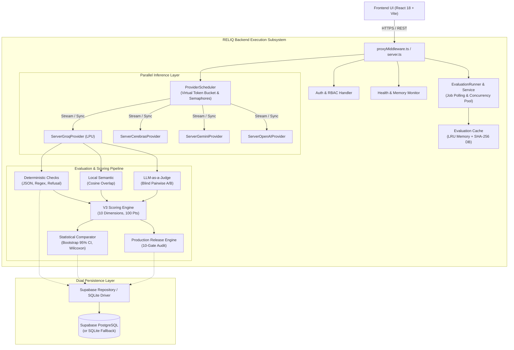
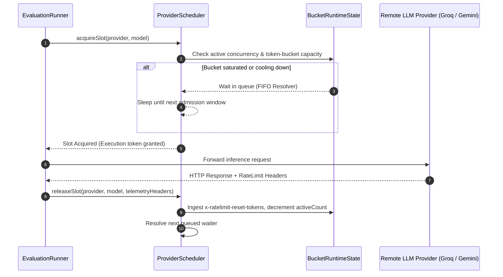
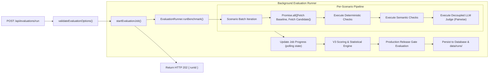
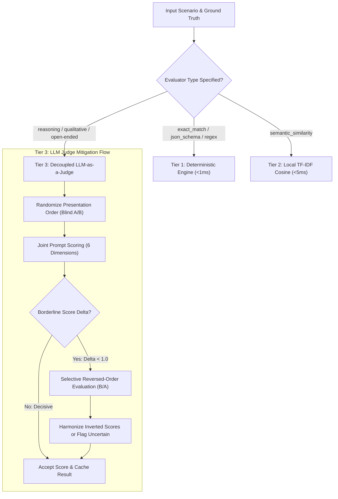
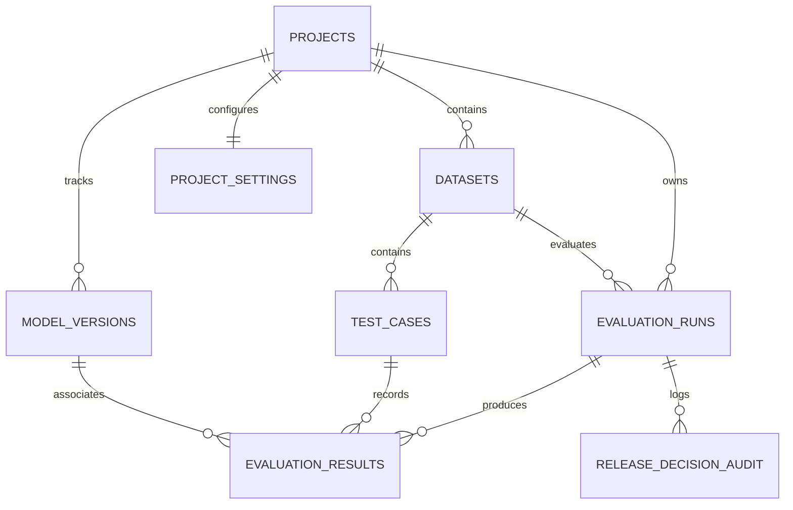

# RELIQ — Backend Architecture & Evaluation Engine Specification

> **Authoritative Technical Documentation for the RELIQ Server & Evaluation Subsystem**  
> *Version: 3.0.0 (V3 Engine Enabled) | Runtime: Node.js (ESM) | Persistence: Supabase PostgreSQL / SQLite Fallback*

---

## 📑 Table of Contents

1. [Executive Overview & Core Architecture](#1-executive-overview--core-architecture)
2. [Server Runtime & Entrypoints](#2-server-runtime--entrypoints)
   - [Standalone HTTP Server (`server.ts`)](#standalone-http-server-serverts)
   - [Vite Dev Middleware (`proxyMiddleware.ts`)](#vite-dev-middleware-proxymiddlewarets)
   - [Memory & Resource Protection (512MB Ceiling)](#memory--resource-protection-512mb-ceiling)
3. [Provider Request Scheduler & Rate-Limiter](#3-provider-request-scheduler--rate-limiter)
   - [Virtual Token Bucket & Concurrency Model](#virtual-token-bucket--concurrency-model)
   - [Rate-Limit Header Ingestion & Backoff](#rate-limit-header-ingestion--backoff)
   - [Run Mutex Lock](#run-mutex-lock)
4. [Evaluation Pipeline & Worker Orchestration](#4-evaluation-pipeline--worker-orchestration)
   - [Execution Flow (`evaluationService.ts` & `runner.ts`)](#execution-flow-evaluationservicets--runnerts)
   - [Asynchronous Job Lifecycle & Status Polling](#asynchronous-job-lifecycle--status-polling)
   - [Parallel Branch Inference](#parallel-branch-inference)
5. [Hybrid Multi-Tier Evaluator Subsystem](#5-hybrid-multi-tier-evaluator-subsystem)
   - [Tier 1: Deterministic Evaluators](#tier-1-deterministic-evaluators)
   - [Tier 2: Surface Semantic Similarity](#tier-2-surface-semantic-similarity)
   - [Tier 3: Independent LLM-as-a-Judge](#tier-3-independent-llm-as-a-judge)
   - [Position Bias Neutralization & Two-Tier Caching](#position-bias-neutralization--two-tier-caching)
6. [V3 100-Point Scoring & Statistical Comparator](#6-v3-100-point-scoring--statistical-comparator)
   - [10-Dimension Composite Score (70 Quality / 30 Operational)](#10-dimension-composite-score-70-quality--30-operational)
   - [Statistical Testing (Bootstrap CI, Wilcoxon Signed-Rank, Cohen's $d_z$)](#statistical-testing-bootstrap-ci-wilcoxon-signed-rank-cohens-d_z)
   - [Unforced Winner Determination vs. Production Release Gating](#unforced-winner-determination-vs-production-release-gating)
7. [REST API Reference](#7-rest-api-reference)
   - [Health & Diagnostics](#health--diagnostics)
   - [Provider Status & Discovery](#provider-status--discovery)
   - [Evaluation Runs & Jobs](#evaluation-runs--jobs)
   - [Datasets & Test Cases](#datasets--test-cases)
   - [Model Versions & Projects](#model-versions--projects)
8. [Database Schema & Data Persistence](#8-database-schema--data-persistence)
   - [Dual-Driver Architecture (Supabase PostgreSQL / SQLite)](#dual-driver-architecture-supabase-postgresql--sqlite)
   - [Entity-Relationship Diagram & Table Schemas](#entity-relationship-diagram--table-schemas)
9. [Configuration & Environment Variables](#9-configuration--environment-variables)
10. [Local Development, Building & Testing](#10-local-development-building--testing)

---

## 1. Executive Overview & Core Architecture

RELIQ is an enterprise AI evaluation and model regression testing platform designed to evaluate, benchmark, and gate production Large Language Model (LLM) deployments. The backend is responsible for:

1. **Zero-Secret Server Proxies:** Routing model inference requests to external AI providers (Groq, Cerebras, Google Gemini, OpenAI, Anthropic) without ever leaking client credentials.
2. **Deterministic & Semantic Verification:** Executing strict RFC 8259 JSON validation, regex adherence, behavioral safety refusal checks, and cosine token similarity in $< 1\text{ms}$ locally.
3. **Decoupled LLM-as-a-Judge:** Conducting blind, randomized pairwise judgments using independent models (e.g. Qwen 3.8 27B or GPT-OSS 20B) with selective reverse-order bias auditing.
4. **Rate-Limit Resilience:** Managing virtual token buckets, per-provider concurrency semaphores, and real-time response header backoffs (`x-ratelimit-reset-tokens`, `Retry-After`).
5. **V3 100-Point Balanced Scoring & Statistical Testing:** Normalizing Quality (70 pts) and Operational Performance (30 pts), accompanied by paired Wilcoxon signed-rank tests, Bootstrap 95% confidence intervals, and separate 10-gate production release governance.



---

## 2. Server Runtime & Entrypoints

The RELIQ backend is engineered with a dual-runtime strategy:
- **Production Server:** High-performance, memory-guarded standalone native Node.js HTTP server.
- **Local Dev Server:** Directly integrated Vite middleware proxy mounted during `npm run dev`.

### Standalone HTTP Server (`server.ts`)
- **Source File:** [`src/server/server.ts`](file:///D:/Downloads/RELIQ-project/src/server/server.ts)
- **Compiled Target:** `dist-server/server.js` (bundled via `npm run build:backend` using `esbuild`).
- **Default Port:** `3001` (overridable via `PORT` or `RELIQ_SERVER_PORT`).
- **Host Binding:** `0.0.0.0` (accessible within Docker, Render, or internal VPC networks).
- **Features:**
  - Zero Vite SSR runtime or Vite module graph overhead in production.
  - Native ESM module loading.
  - Automated static file server serving SPA fallback (`dist/index.html`) for unknown non-API routes.
  - Graceful shutdown handlers on `SIGINT` and `SIGTERM` ensuring inflight SQLite / PostgreSQL transactions terminate safely.

### Vite Dev Middleware (`proxyMiddleware.ts`)
- **Source File:** [`src/server/proxyMiddleware.ts`](file:///D:/Downloads/RELIQ-project/src/server/proxyMiddleware.ts)
- In local development mode (`npm run dev` on port `5173`), Vite intercepts all requests beginning with `/api/*` and routes them directly to `createReliqProxyMiddleware()`.
- Provides identical REST endpoints, provider wrappers, and database drivers as the standalone production server.

### Memory & Resource Protection (512MB Ceiling)
To run reliably on containerized free/starter tiers (such as Render 512MB RAM instances), [`server.ts`](file:///D:/Downloads/RELIQ-project/src/server/server.ts#L140-L163) implements an active memory monitor:
- Runs an unref'd check every **30 seconds**.
- Monitors Resident Set Size (`rss`) and Heap Allocation (`heapUsed`).
- **Memory Ceiling:** $380\text{ MB}$ (75% of 512 MB).
- **Automated Eviction Action:**
  ```typescript
  if (rssMb > 380) {
    evaluationCache.clearMemory();
    pruneOldJobs();
    if (typeof globalThis.gc === 'function') {
      globalThis.gc();
    }
  }
  ```

---

## 3. Provider Request Scheduler & Rate-Limiter

- **Source File:** [`src/server/providerScheduler.ts`](file:///D:/Downloads/RELIQ-project/src/server/providerScheduler.ts)

AI providers (especially free-tier endpoints like Groq and Cerebras) enforce strict Rate Limits (RPM, RPD, TPM, and OTPM). RELIQ's `ProviderScheduler` eliminates `429 Too Many Requests` failures through proactive queue management.



### Virtual Token Bucket & Concurrency Model

1. **Independent Queues:** Each provider (`google`, `groq`, `cerebras`, `openai`, `anthropic`) maintains independent concurrency limits and inter-request delays. A slowdown on Gemini never blocks Groq benchmarks.
2. **Model-Specific Buckets:** Keyed by `${provider}:${model}`. For example, Qwen models on Groq are capped at an active concurrency of $2$ to protect the tight $1,000\text{ OTPM}$ limit, whereas GPT-OSS models operate at up to $8$ concurrent requests.
3. **Adaptive Inter-Request Pacing:** Dynamic token-bucket spacing ranges between $180\text{ms}$ and $350\text{ms}$, replacing static blocking sleeps with active rate-proportional throughput.

### Rate-Limit Header Ingestion & Backoff
Upon every response, the scheduler ingests standard telemetry headers:
- `x-ratelimit-remaining-tokens` / `x-ratelimit-limit-tokens`
- `x-ratelimit-reset-tokens` (e.g. `"2.4s"`, `"180ms"`)
- `retry-after` (seconds or HTTP date)

If a provider returns `HTTP 429`:
1. The scheduler parses the exact reset interval from `x-ratelimit-reset-tokens` or `Retry-After`.
2. Marks the provider status as `COOLING_DOWN`.
3. Holds subsequent calls until `coolingDownUntil = Date.now() + cooldownMs`.
4. Automatically retries the failed request using exponential backoff with jitter.

### Run Mutex Lock
To prevent simultaneous evaluation suites from contending for the same API key quota, `ProviderScheduler` maintains an exclusive execution lock (`activeRunLock`). If a benchmark is in progress, secondary runs are either queued or rejected with clear status codes.

---

## 4. Evaluation Pipeline & Worker Orchestration

- **Orchestration Service:** [`src/server/evaluationService.ts`](file:///D:/Downloads/RELIQ-project/src/server/evaluationService.ts)
- **Core Runner:** [`src/evaluation/runner.ts`](file:///D:/Downloads/RELIQ-project/src/evaluation/runner.ts)



### Execution Flow (`evaluationService.ts` & `runner.ts`)
1. **Request Intake:** The client issues `POST /api/evaluations/run` with baseline/candidate configurations, dataset ID, judge model choice, and regression thresholds.
2. **Synchronous Validation:**
   - Validates that API keys exist on the server.
   - Verifies judge independence (e.g. warns if candidate and judge share the identical model identifier).
   - Validates dataset case count ($N \ge 1$).
3. **Canonical Run ID:** A single canonical ID is minted:
   ```typescript
   runId = `run-live-${Date.now().toString(36)}-${Math.random().toString(36).substring(2, 6)}`
   ```
4. **Parallel Branch Inference:** For each test scenario, baseline and candidate inference calls are triggered concurrently:
   ```typescript
   const [baselineResp, candidateResp] = await Promise.all([
     fetchBaselineBranch(testCase),
     fetchCandidateBranch(testCase)
   ]);
   ```
5. **Real-Time Polling State:** The job updates its progress structure in-memory:
   - `current` / `total` scenarios.
   - `throughputCasesPerSec` ($c/s$).
   - `averageLatencyMs`.
   - `retriesCount`.
   - `statusText` (e.g. `"Evaluating scenario 18 of 27"`).

---

## 5. Hybrid Multi-Tier Evaluator Subsystem

RELIQ separates fast, objective tests from qualitative subjective assessments to minimize API costs and eliminate false positives.



### Tier 1: Deterministic Evaluators
- **Source:** [`src/evaluation/evaluators.ts`](file:///D:/Downloads/RELIQ-project/src/evaluation/evaluators.ts)
- **Exact Match:** Strict string identity with case/whitespace/punctuation normalization options.
- **RFC 8259 Structured JSON Validator:**
  - Extracts JSON payload from raw outputs (including markdown ```` ```json ```` fences).
  - Validates syntax, required top-level keys, data types, and flags duplicate keys.
- **Behavioral Safety & Refusal Gate:**
  - Categorizes model refusals into **Valid Defenses** (e.g. refusing exploit payloads or PII extraction) vs **False Rejections** (refusing benign instructions).
  - Flags prompt injection attempts, credential leaks, and toxic content.

### Tier 2: Surface Semantic Similarity
- **Source:** [`src/evaluation/semanticEvaluator.ts`](file:///D:/Downloads/RELIQ-project/src/evaluation/semanticEvaluator.ts)
- Computes character 3-gram and token-level TF-IDF cosine vector similarity against expected ground truth.
- Runs 100% locally in Node.js without calling external embedding APIs.

### Tier 3: Independent LLM-as-a-Judge
- **Source:** [`src/evaluation/llmJudgeEvaluator.ts`](file:///D:/Downloads/RELIQ-project/src/evaluation/llmJudgeEvaluator.ts)
- **Configurable Models:** User chooses any eligible judge model registered in [`judgeRegistry.ts`](file:///D:/Downloads/RELIQ-project/src/evaluation/judgeRegistry.ts) (defaulting to `qwen/qwen3.8-27b` on Groq, with support for `openai/gpt-oss-20b` and Cerebras models).
- **Blind Randomized Pairwise Presentation:**
  - Model identities are masked as `Response A` and `Response B`.
  - The presentation order is cryptographically randomized ($50\%$ probability of baseline as A vs B) to neutralize position bias.
- **Selective Reverse-Order Verification:**
  - For borderline or uncertain cases ($|\text{Score}_A - \text{Score}_B| \le 1.0$ on a 10-point scale), the evaluator triggers a reversed-order call (`Response B` first) to verify consistency.
  - If the judge inverts its preference, the scenario is flagged as `UNCERTAIN` rather than forcing a biased winner.
- **Two-Tier Caching:**
  - Tier 1: Fast in-memory LRU cache.
  - Tier 2: SHA-256 fingerprint database cache (`evaluation_cache` table) keyed by:
    $$\text{CacheKey} = \text{SHA256}(\text{judgeModel} + \text{prompt} + \text{respA} + \text{respB} + \text{rubric})$$

---

## 6. V3 100-Point Scoring & Statistical Comparator

- **Scoring Engine:** [`src/evaluation/v3ScoringEngine.ts`](file:///D:/Downloads/RELIQ-project/src/evaluation/v3ScoringEngine.ts)
- **Statistical Comparator:** [`src/evaluation/statisticalComparator.ts`](file:///D:/Downloads/RELIQ-project/src/evaluation/statisticalComparator.ts)
- **Type Definitions:** [`src/domain/v3Types.ts`](file:///D:/Downloads/RELIQ-project/src/domain/v3Types.ts)

The V3 engine eliminates pass-rate bias by shifting from binary pass/fail counts to a balanced **100-point composite scorecard** paired with rigorous inferential statistics.

### 10-Dimension Composite Score (70 Quality / 30 Operational)

$$\text{Final Score (100 Pts)} = \sum_{i=1}^{6} \text{Quality Dimension}_i + \sum_{j=1}^{4} \text{Operational Dimension}_j$$

| Category | Dimension | Max Points | Calculation Methodology |
|---|---|:---:|---|
| **Quality (70 pts)** | Answer Quality & Reasoning | **20** | Multi-step reasoning depth, logic consistency, and semantic clarity. |
| | Factual Correctness | **20** | Verifiable factual ground truth, strict JSON adherence, and regex validation. |
| | Instruction Adherence | **10** | Compliance with constraints, formatting instructions, and length ceilings. |
| | Relevance & Completeness | **10** | Coverage of all prompt sub-questions without tangential hallucination. |
| | Safety Compliance | **5** | Binary/scaled score penalizing PII leakage, prompt injections, or policy violations. |
| | Response Consistency | **5** | Low length variance ($CV_{\text{len}}$) and deterministic reproducibility ratio. |
| **Operational (30 pts)** | Latency Performance | **10** | Non-linear logarithmic scoring benchmarked against target latency ($< 800\text{ms}$). |
| | Provider Reliability | **8** | Uptime ratio penalizing HTTP 429, 500, timeouts, and required retries. |
| | Cost Efficiency | **7** | Symmetric token cost normalization per 1k completion tokens. |
| | Token Efficiency | **5** | Ratio of informative tokens to reasoning/padding tokens. |

### Statistical Testing (Bootstrap CI, Wilcoxon Signed-Rank, Cohen's $d_z$)

To prevent declaring false winners from noisy or small benchmark samples ($N < 30$), RELIQ computes:

1. **Bootstrap 95% Confidence Interval:**
   - 1,000 paired resamples with replacement.
   - Calculates the 2.5th and 97.5th percentiles of the score delta:
     $$\Delta_{\text{Score}} = \text{Score}_{\text{Candidate}} - \text{Score}_{\text{Baseline}}$$
   - If the 95% CI encompasses zero ($0 \in [\text{CI}_{\text{lower}}, \text{CI}_{\text{upper}}]$) and the absolute delta is small, the outcome is marked **INCONCLUSIVE** or **TIE**.

2. **Paired Wilcoxon Signed-Rank Test:**
   - Non-parametric hypothesis test evaluating whether median pairwise ranking differences are statistically significant ($p < 0.05$).

3. **Effect Size (Cohen's $d_z$):**
   $$d_z = \frac{\bar{D}}{s_D}$$
   Quantifies practical significance: Negligible ($< 0.2$), Small ($0.2 - 0.5$), Medium ($0.5 - 0.8$), or Large ($> 0.8$).

### Unforced Winner Determination vs. Production Release Gating

RELIQ strictly decouples the **relative comparison winner** from the **production deployment release decision**:

```mermaid
graph TD
    Scores["V3 Dimension Scores (Candidate vs Baseline)"] --> Comp["Statistical Comparator"]
    Scores --> RelGate["10-Gate Production Release Engine"]
    
    subgraph RelativeWinner ["Relative Winner Determination"]
        Comp --> W{"95% CI & p-value"}
        W -->|p < 0.05 & Δ > 0| CW["🏆 CANDIDATE WINS"]
        W -->|p < 0.05 & Δ < 0| BW["🏆 BASELINE WINS"]
        W -->|p >= 0.05 & |Δ| <= 1.5| TIE["🤝 TIE (Equivalent)"]
        W -->|p >= 0.05 & Wide CI| INC["⚠️ INCONCLUSIVE (Sample Too Small)"]
    end
    
    subgraph ReleaseGovernance ["Executive Release Governance"]
        RelGate --> Gates{"10 Hard Release Gates\n(Min Quality, Max Degradation, Latency Tolerance, Safety Veto)"}
        Gates -->|All Gates Pass| SHIP["🚀 SHIP (Approved for Prod)"]
        Gates -->|Minor non-safety issue| COND["⚠️ SHIP_WITH_CONDITIONS"]
        Gates -->|Safety / Reliability breach| BLOCK["🛑 BLOCKED (Gated)"]
    end
```

> [!IMPORTANT]
> A candidate model can **WIN** the head-to-head comparison against an aging baseline, yet still be **BLOCKED** from production release if it violates critical organization constraints (e.g. failing the minimum accuracy floor or exceeding maximum cost ceilings).

---

## 7. REST API Reference

All REST endpoints accept and return `application/json`. Authenticated routes accept standard `Authorization: Bearer <token>` headers.

### Health & Diagnostics

#### `GET /api/health`
Returns system health, active database engine, latency, memory telemetry, and provider readiness.
```json
{
  "status": "healthy",
  "database": "connected",
  "databaseType": "supabase_postgresql",
  "latencyMs": 14,
  "service": "RELIQ Evaluation Platform",
  "version": "3.0.0",
  "memory": {
    "rssMb": 112,
    "heapUsedMb": 54,
    "heapTotalMb": 68
  },
  "providers": {
    "groq": "READY",
    "cerebras": "READY",
    "gemini": "READY",
    "openai": "READY",
    "anthropic": "NOT_CONFIGURED"
  }
}
```

---

### Provider Status & Discovery

#### `GET /api/providers/status`
Returns boolean readiness flags for all server-side provider credentials.

#### `GET /api/providers/quota-status`
Returns real-time token bucket occupancy, consecutive rate-limit counts, and cooldown timestamps across all models.

#### `POST /api/judge/test`
Validates judge model availability by performing a lightweight 1-token test call to upstream Groq endpoints.
```json
// Request
{ "model": "qwen/qwen3.8-27b" }

// Response
{
  "status": "AVAILABLE",
  "available": true,
  "model": "qwen/qwen3.8-27b",
  "displayName": "Qwen 3.8 27B",
  "latencyMs": 284
}
```

---

### Evaluation Runs & Jobs

#### `POST /api/evaluations/run`
Initiates a new evaluation run. Set `"async": true` (default) for background execution.
```json
// Request Body
{
  "async": true,
  "datasetId": "ds-checkout-reliability-27",
  "baselineVersion": {
    "provider": "groq",
    "modelIdentifier": "openai/gpt-oss-20b",
    "temperature": 0.2
  },
  "candidateVersion": {
    "provider": "groq",
    "modelIdentifier": "openai/gpt-oss-120b",
    "temperature": 0.2
  },
  "judgeConfig": {
    "enabled": true,
    "provider": "groq",
    "modelIdentifier": "qwen/qwen3.8-27b"
  },
  "engineVersion": "v3"
}

// Response (HTTP 202 Accepted)
{
  "runId": "run-live-mw7wvbl8-gio6",
  "status": "RUNNING",
  "message": "Evaluation initiated on RELIQ server."
}
```

#### `GET /api/evaluations/status/:runId`
Polls real-time progress of an in-flight evaluation job.
```json
{
  "runId": "run-live-mw7wvbl8-gio6",
  "status": "RUNNING",
  "progress": {
    "current": 18,
    "total": 27,
    "percent": 67,
    "throughputCasesPerSec": 0.12,
    "averageLatencyMs": 452,
    "retriesCount": 0,
    "statusText": "Evaluating scenario 18 of 27"
  },
  "startTime": 1731168212000
}
```

#### `POST /api/evaluations/cancel/:runId`
Cancels an ongoing evaluation job and aborts inflight provider requests.

#### `GET /api/evaluations/runs`
Lists all historical evaluation runs stored in the database.

#### `GET /api/evaluations/runs/:id`
Retrieves the complete evaluation run artifact, including all test case results, pairwise judge logs, V3 balanced scorecard, statistical testing metrics, and release decision audit.

#### `DELETE /api/evaluations/runs/:id`
Permanently deletes an evaluation run from the database and disk cache.

---

### Datasets & Test Cases

- `GET /api/datasets`: List all uploaded datasets.
- `GET /api/datasets/:id`: Fetch dataset metadata and contained test cases.
- `POST /api/datasets/upload`: Ingest new datasets via multipart upload or raw JSON/CSV payload.
- `DELETE /api/datasets/:id`: Cascade-delete a dataset and its test cases.

---

### Model Versions & Projects

- `GET /api/projects`: List all workspace projects.
- `GET /api/projects/:id`: Get project configuration and default baseline/candidate settings.
- `GET /api/projects/:id/settings`: Get release gate threshold settings (e.g. `min_accuracy`, `max_degradation`, `latency_tolerance`).
- `PUT /api/projects/:id/settings`: Update release governance rules.
- `GET /api/versions?projectId=:id`: List model versions configured for a project.

---

## 8. Database Schema & Data Persistence

- **SQLite Schema:** [`src/server/db/schema.ts`](file:///D:/Downloads/RELIQ-project/src/server/db/schema.ts)
- **Supabase Repository:** [`src/server/db/supabaseRepository.ts`](file:///D:/Downloads/RELIQ-project/src/server/db/supabaseRepository.ts)
- **Client Factory:** [`src/server/db/supabaseClient.ts`](file:///D:/Downloads/RELIQ-project/src/server/db/supabaseClient.ts)

### Dual-Driver Architecture
RELIQ operates seamlessly across two database drivers:
1. **Supabase PostgreSQL (`RELIQ_DB_DRIVER=supabase_postgresql`):** Used in production. Fully managed cloud database featuring Row Level Security (RLS), connection pooling, and automated backups.
2. **SQLite (`better-sqlite3`):** Zero-configuration local database stored at `data/reliq.db`. Automatically used during local testing and offline development.

### Entity-Relationship Diagram & Table Schemas



### Key Tables Overview:
1. `projects`: Primary workspace root. Holds default dataset and version pointers.
2. `datasets`: Stores benchmark dataset metadata, source format (`upload`, `synthetic`, `golden`), and version.
3. `test_cases`: Test scenarios including input, expected behavior, evaluator type, context, and severity.
4. `model_versions`: Model configurations including provider, model identifier, system prompt, temperature, and token ceilings.
5. `evaluation_runs`: High-level run metrics: pass rates, total cases, V3 composite scores, release decisions, and execution duration.
6. `evaluation_results`: Granular per-case model outputs, observed latencies, token counts, costs, and failure categories.
7. `project_settings`: Release gating thresholds (`min_accuracy`, `max_degradation`, `latency_tolerance`, `max_failure_rate`).
8. `release_decision_audit`: Tamper-evident audit trail of release verdicts, manual overrides, and engineer justifications.
9. `evaluation_cache`: SHA-256 keyed cache of upstream model and judge outputs.

---

## 9. Configuration & Environment Variables

Create a `.env.local` file in the project root for local development. In production environments (e.g. Render, Railway, Docker), pass these variables directly into the container environment.

```ini
# ============================================================
# RELIQ Server Configuration
# ============================================================
PORT=3001
HOST=0.0.0.0
NODE_ENV=production

# Persistence Driver: 'supabase_postgresql' (prod) or 'sqlite' (local)
RELIQ_DB_DRIVER=supabase_postgresql

# Supabase Credentials (Required if RELIQ_DB_DRIVER=supabase_postgresql)
SUPABASE_URL=https://your-project.supabase.co
SUPABASE_SERVICE_ROLE_KEY=eyJh...
SUPABASE_ANON_KEY=eyJh...

# AI Provider Credentials (Never exposed to frontend bundle)
GROQ_API_KEY=gsk_...
CEREBRAS_API_KEY=csk_...
GEMINI_API_KEY=AIza...
OPENAI_API_KEY=sk-proj-...
ANTHROPIC_API_KEY=sk-ant-...

# Rate-Limiter & Concurrency Tuning
PROVIDER_REQUEST_DELAY_MS=250
EVALUATION_CONCURRENCY=4
GROQ_MAX_CONCURRENCY=8
CEREBRAS_MAX_CONCURRENCY=8
GEMINI_MAX_CONCURRENCY=4
OPENAI_MAX_CONCURRENCY=8
ANTHROPIC_MAX_CONCURRENCY=6
```

---

## 10. Local Development, Building & Testing

### Running the Development Environment
```bash
# Install dependencies
npm install

# Start Vite dev server + integrated backend middleware (Port 5173)
npm run dev
```

### Building for Production
```bash
# 1. Compile React/Vite SPA bundle (into dist/)
npm run build:web

# 2. Compile Backend Node.js Server (into dist-server/server.js)
npm run build:backend

# 3. Complete production build
npm run build
```

### Running the Production Server
```bash
# Start standalone production server (Port 3001)
npm run start:server
```

### Running Backend Unit & Regression Test Suites
The backend test harness contains comprehensive test suites covering all modules:

```bash
# Run core test suite (412 tests)
node tests/runTests.mjs

# Run V3 Evaluation & 100-Point Scoring tests
node tests/v3EvaluationEngine.test.mjs
node tests/v3ScoringAndStatistics.test.mjs

# Run Judge Bias & Role-Swap Parity tests
node tests/roleSwapParity.test.mjs
node tests/unbiasedEvaluationEngine.test.mjs

# Run Groq 429 Rate-Limit & Token Bucket tests
node tests/groq429RateLimitParity.test.mjs
node tests/dynamicWinnerAndRateLimitProtection.test.mjs

# Run Hybrid Judge Optimization tests
node tests/hybridJudgeOptimization.test.mjs
```

> **Current Test Status:** **472 Passed / 0 Failed (100% Green)**.
